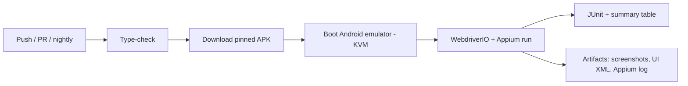

# Appium Mobile Framework

[](https://github.com/guillermocuenya/appium-mobile-framework/actions/workflows/ci.yml)


> Mobile end-to-end automation for a native Android shopping app with **WebdriverIO + Appium (UiAutomator2) + TypeScript**, using the Screen Object Model and running on a **real Android emulator in CI** on every push.

**19 tests + 2 quarantined defect reproductions · 5 suites · full purchase flow from guest to order confirmation · 2 crash bugs found and root-caused.**

## System under test

[Sauce Labs **My Demo App** (Android)](https://github.com/saucelabs/my-demo-app-android) — a public, realistic native shopping app used across the industry for mobile automation practice. The pipeline downloads a **pinned release** of the APK, so results are reproducible.

## What it demonstrates

| Area | How |
|---|---|
| **Mobile automation** | Appium 3 + UiAutomator2 driving a native Android app; gestures, scrolling (`UiScrollable`), keyboard handling, system back, dialogs |
| **Architecture** | Screen Object Model with a `BaseScreen`, a shared `HeaderBar` component, typed test data and an independent product oracle |
| **Locator strategy** | resource-id first, accessibility id second, text only when nothing else is unique — documented in [`locators.ts`](src/utils/locators.ts) |
| **Test isolation** | Every test starts from a clean app (`mobile: clearApp` + relaunch): no order dependency, no leftover cart or session |
| **Coverage** | Sorting (3 orders) checked as an ordering property against a 24-product oracle, prices, product detail, quantity rules, cart totals, login rules, guest → login → checkout redirect, form validation, full purchase |
| **Debuggability** | On failure: screenshot + **UI hierarchy XML** + **logcat crash trace** + Appium server log, uploaded as CI artifacts |
| **CI/CD** | GitHub Actions: type-check gate → Android emulator (KVM-accelerated) → JUnit → test summary table in the run page; nightly schedule; matrix ready for more API levels |
| **Cloud-ready** | [`wdio.sauce.conf.ts`](config/wdio.sauce.conf.ts) runs the same suite on a real-device cloud — switching provider is configuration only |

## Findings worth mentioning

Things the suite surfaced while being built — the kind of detail that matters in real projects:

0. **🐞 Crash defects (BUG-001 / BUG-002).** On a real emulator the app crashed ("My Demo App keeps stopping") when opening some products. Logcat capture on failure plus the app's source pinpointed the root cause: the tap handler reads `meta[position]` from `[0, null, 2, 3, 4, 5]` → `NullPointerException` for the 2nd product and `ArrayIndexOutOfBoundsException` from the 7th on. Business flows use crash-safe products, and the defects live in a **quarantined** suite ([`known-defects.spec.ts`](test/specs/known-defects.spec.ts)) that documents reproduction and is re-enabled to verify the fix — so the pipeline stays a trustworthy signal.
1. **Only the product image is clickable** in the catalog; tapping the title does nothing. Users tend to tap the title, so this is a usability issue worth reporting. The Screen Object locates the card by title and taps the image in the same card (XPath scoped to the card, not a global index).
2. **Quantity can be set to 0** on the product detail screen. The app handles it by disabling *Add To Cart* — the test pins that behaviour so a regression (adding 0 items, or negative quantities) is caught.
3. **Checkout requires login, but not up front**: a guest can fill the cart and is redirected to login when proceeding to checkout, then continues to the shipping step. The end-to-end test covers this real path instead of logging in first.
4. **The oracle must match the exact build under test.** The app's main branch ships 6 products, but the pinned release 2.3.0 has 24 (colour variants). The first CI run on a real emulator caught the mismatch; the oracle now mirrors the release, and ordering is asserted as a *property* (every pair in order, SQLite binary collation) because several products share a price.
5. **`UiScrollable` can hang the device in nested lists.** The product grid is a RecyclerView inside a ScrollView; `scrollIntoView` swiped the wrong (non-scrollable) container until the UiAutomator2 server died and every following test failed. Replaced with a bounded `mobile: scrollGesture` loop on the real container, plus session self-healing.
6. **Taps during a scroll fling are swallowed.** Tapping a product right after scrolling sometimes only stopped the list. The Screen Object waits until the element stops moving before tapping — a reliability fix, not a `sleep`.
7. **A resource-id typo in the app** (`shoopingBt` on the confirmation screen) — documented in the Screen Object so nobody "fixes" the locator and breaks the test.

## Test strategy

| Risk | Impact | Covered by |
|---|---|---|
| A customer cannot complete a purchase | 🔴 High | Full E2E: guest → login → shipping → payment → review → confirmation (`@smoke`) |
| Wrong amount charged | 🔴 High | Cart totals for one and several products; review total = items + delivery fee |
| Cart not emptied after ordering (double order) | 🔴 High | Post-order badge check |
| Locked or invalid accounts get in | 🟠 Medium | Locked user, missing username, missing password |
| Invalid shipping/payment data accepted | 🟠 Medium | Required-field validation on both forms |
| Products shown in the wrong order / wrong price | 🟠 Medium | 3 sort orders + default order + price checks vs. the product oracle |

`@smoke` tags the minimum set that must pass before anything else matters (`npm run test:smoke`).

## Project structure

```
config/
  wdio.shared.conf.ts     Common settings, JUnit reporter, failure evidence hook
  wdio.android.conf.ts    Local emulator / CI (Appium started by the WDIO service)
  wdio.sauce.conf.ts      Same suite on Sauce Labs real devices
src/
  screens/                Screen Objects: Catalog, ProductDetail, Cart, Login, Checkout (4 steps), HeaderBar
  data/                   Product oracle and synthetic checkout data
  utils/                  Locator helpers, app reset, money formatting
test/specs/               catalog · cart · login · checkout · known-defects (quarantined)
scripts/
  download-app.sh         Fetches the pinned APK release
  junit-summary.mjs       JUnit → Markdown summary in the GitHub Actions run
.github/workflows/ci.yml  Type-check gate + Android emulator job
```

## Run it locally

Requirements: Node 22+, Android SDK with an emulator (Android Studio), `ANDROID_HOME` set, and the [GitHub CLI](https://cli.github.com/) to download the app.

```bash
npm ci                             # also installs the pinned UiAutomator2 driver
./scripts/download-app.sh          # → apps/mda.apk
# start an emulator from Android Studio (or: emulator -avd <name>)
npm run test:android               # full suite
npm run test:smoke                 # @smoke only
```

## CI pipeline



## How I used AI

Built with AI pair-programming (Claude Code), the way I use it at work: AI speeds up the boilerplate, while **I own the test design** — the risk analysis, the locator strategy and verifying behaviour against the app's real source code. For example, the "only the image is clickable" finding came from reading the app's adapter code, not from trial and error.

---

## Author

**Guillermo Cuenya** — Software Engineer · Senior QA Automation / SDET · Telecommunications Engineer
[LinkedIn](https://www.linkedin.com/in/guillermoadriancuenya/) · [GitHub](https://github.com/guillermocuenya) · [Portfolio](https://guillermocuenya.github.io)
